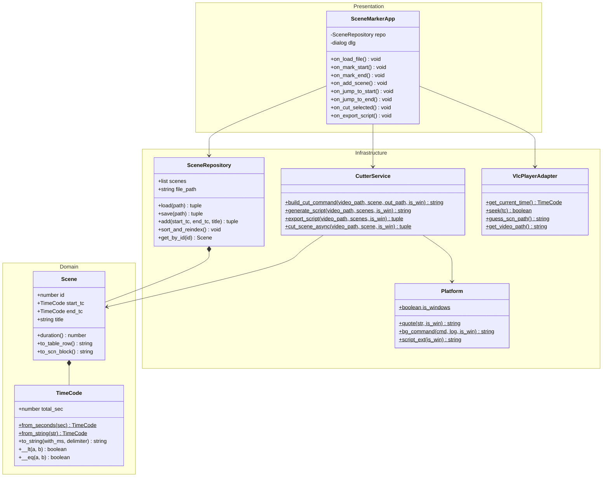

# VLC Scene Marker

A modern, object-oriented VLC media player extension written in Lua for video fragment capture, scene navigation, `.scn` file persistence, and FFmpeg video cutting.

---

## Features

- **⏱️ Mark In & Mark Out**: Capture current playback timestamps with millisecond accuracy directly from playing media.
- **💾 Automatic `.scn` Persistence**: Auto-guesses the `.scn` file location based on video file path, parses subtitle-like scene blocks, and saves updates.
- **🔄 Auto-Sorting & Reindexing**: Newly captured scenes are sorted chronologically and assigned sequential IDs (1..N).
- **▶ Non-Blocking Navigation**: Jump to scene Start or End timestamps instantly without VLC interface thread locks.
- **✂️ FFmpeg Video Cutting**:
  - **Cut Selected Scene**: Executes an asynchronous, lossless stream copy (`-c copy`) in the background.
  - **Export Cut Script**: Generates a self-contained batch script (`.sh` for Linux or `.bat` for Windows) next to your video for one-click processing.
- **🌐 Cross-Platform Compatibility**: Full support for Linux (POSIX shell, Snap confinement) and Windows (`cmd.exe` batch files, `start /B` background tasks).

---

## Architecture & Design

The codebase adheres to Clean Architecture and Object-Oriented Domain-Driven Design principles:



### Components

1. **`TimeCode`** (Value Object): Immutable timestamp representation with fractional millisecond arithmetic, comparison operators (`<`, `<=`, `==`), and flexible delimiter formatting (`:`/`,`/`.`).
2. **`Scene`** (Domain Entity): Invariant validation (`end_time > start_time`), formatting for table rows and `.scn` file format blocks.
3. **`SceneRepository`** (Repository): Streaming `.scn` parser with chronological sorting and atomic writing.
4. **`Platform`** (Infrastructure Abstraction): OS detection via `package.config`, argument quoting, and background execution formatting.
5. **`CutterService`** (Domain Service): Builds lossless FFmpeg commands and exports `.sh` / `.bat` scripts.
6. **`VlcPlayerAdapter`** (Port Adapter): Decouples VLC C-API (`vlc.object.input()`, `vlc.var.get/set`) from the presentation logic.
7. **`SceneMarkerApp`** (Presentation): Manages the VLC dialog lifecycle, inputs, and UI widgets.

---

## File Structure

```
scene-maker/
├── src/
│   └── scene-marker.lua      # Standalone extension script for VLC
├── tests/
│   └── test_scene_marker.lua # Standalone headless test suite
├── scripts/
│   └── install.sh            # Installer script for Snap & Native VLC
└── README.md                 # Project documentation
```

---

## Installation

### Linux
Run the installation script:
```bash
./scripts/install.sh
```
Or manually copy `src/scene-marker.lua` to:
- **Snap VLC**: `~/snap/vlc/current/.local/share/vlc/lua/extensions/`
- **Native VLC**: `~/.local/share/vlc/lua/extensions/`

### Windows
Copy `src/scene-marker.lua` to:
```
%APPDATA%\vlc\lua\extensions\scene-marker.lua
```

---

## Usage

1. Open VLC Media Player and start playing a video.
2. In the menu bar, open: **View** -> **Scene Marker**.
3. The `.scn` file path is auto-detected. If an `.scn` file already exists, it is loaded automatically.
4. **Marking a Fragment**:
   - Click `[ ⏱️ Mark Start (In) ]` at the fragment start.
   - Click `[ ⏱️ Mark End (Out) ]` at the fragment end.
   - Enter a title (or leave blank for auto-generated `Scene N`).
   - Click `[ ➕ Add & Save Scene ]`.
5. **Navigating**:
   - Select a row in the list and click `[ ▶ Jump to Start ]` or `[ ⏹ Jump to End ]`.
6. **Cutting Video**:
   - Click `[ ✂️ Cut Selected Scene ]` to cut the selected fragment in the background.
   - Click `[ 📄 Export Cut Script ]` to create a `movie_cut_scenes.sh` (or `.bat`) batch script right next to your video.

---

## Running Tests

The test suite runs headlessly using `luajit` or standard `lua5.1` / `lua5.2`:

```bash
luajit tests/test_scene_marker.lua
```
